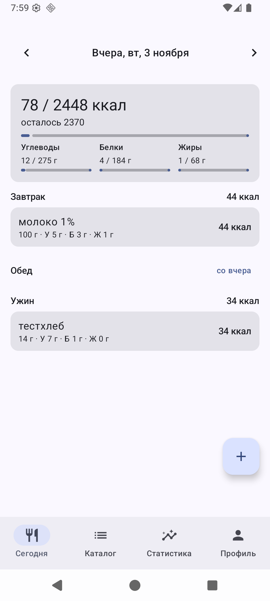

# YACT — Yet Another Calorie Tracker

[](https://github.com/seriousdev-gh/yact/actions/workflows/ci.yml)

Офлайн-first счётчик калорий и БЖУ под Android. Без аккаунтов, без рекламы,
без обязательной сети — все данные живут в локальной базе на устройстве.



## Возможности

- **Дневник** — приёмы пищи по дням (завтрак/обед/ужин/перекус), копирование вчерашнего дня, редактирование записи через тот же диалог порций.
- **Каталог продуктов** — поиск, избранное, недавние; несколько порций у продукта (100 г, стакан, ложка…), порция подставляется по умолчанию.
- **Рецепты** — состав из продуктов и порций, добавление в дневник как одного целого.
- **Нормы** — расчёт по Миффлину–Сан Жеору из профиля (пол/возраст/рост/вес/активность); режимы цели: авто, только ккал, ккал + БЖУ.
- **Статистика** — графики по дням, весу, средним за период.
- **Штрихкоды** — скан камеры (ML Kit) и импорт продукта из Open Food Facts.
- **Распознавание этикеток** — фото + vision-LLM на ваш вкус (OpenRouter или любой OpenAI-совместимый endpoint: base URL, ключ и модель задаются в настройках, вызов только после явного согласия).
- **Бэкап** — экспорт/импорт базы одним файлом с перезапуском приложения после импорта.
- **Тема** — системная / светлая / тёмная + динамические цвета Material You.

## Конфиденциальность

- Приложение не собирает и не отправляет статистику; аккаунтов нет.
- Вся еда, профиль и вес — только в Room на устройстве.
- Сеть используется точечно: поиск штрихкодов в Open Food Facts и распознавание этикеток на endpoint, который вы указали сами. Оба выключены, пока вы ими не пользуетесь.

## Сборка

Требуется JDK 21+ и Android SDK (compileSdk 37).

```bash
# local.properties: sdk.dir=/path/to/Android/sdk
./gradlew :app:assembleDebug          # APK: app/build/outputs/apk/debug/
./gradlew :app:testDebugUnitTest      # unit-тесты (Robolectric)
./gradlew :app:lintRelease
```

Release-сборка подписывается, если в корне лежит `keystore.properties`
(`storeFile`, `storePassword`, `keyAlias`, `keyPassword`); без него release
остается неподписанным. Файл в git не попадает.

## Лицензия

[Apache-2.0](LICENSE). Третьи права: Open Food Facts (данные их продуктов),
ML Kit, Jetpack-библиотеки — под своими лицензиями.
